<!--
  =============================================================================
  PERSONA 3 RELOAD (P3R) THEMED PROFILE — CAMILO ANDRÉS RODRÍGUEZ (@camanrofo34)
  =============================================================================
  GENERATED & CONFIGURED VIA p3r.config.json.
  To update featured projects, skills, or status:
    1. Edit p3r.config.json
    2. Run: py -3 scripts/gen_p3r_profile.py (or python3 scripts/gen_p3r_profile.py)
    3. Commit & push — GitHub Actions automatically validates and synchronizes assets.
-->

<!-- ===================================================================== -->
<!-- [00] P3R HERO // WATER SPLASH HUD BANNER -->
<!-- ===================================================================== -->

  

<!-- P3R TYPING STATUS SVG -->

  

 

<!-- ===================================================================== -->
<!-- [01] STATUS // IDENTITY -->
<!-- ===================================================================== -->

  

  

 

<!-- ===================================================================== -->
<!-- [02] TACTICS // OPERATIONS -->
<!-- ===================================================================== -->

  

  <!-- MISSION 01: SEMPIA -->
  
   
  <!-- MISSION 02: PHARMACONSULTAS -->
  
   
  <!-- MISSION 03: TERRAFY -->
  
   
  <!-- MISSION 04: GYM CRM -->
  
   
  <!-- MISSION 05: NEXUS BATTLE IV -->
  

 

<!-- ===================================================================== -->
<!-- [03] SKILLS // ARSENAL -->
<!-- ===================================================================== -->

  

  

 

<!-- ===================================================================== -->
<!-- [04] TROPHIES // HONORS -->
<!-- ===================================================================== -->

  

  

 

<!-- ===================================================================== -->
<!-- GITHUB ANALYTICS (P3R MIDNIGHT & CYAN THEME) -->
<!-- ===================================================================== -->

  

 

  
  

 

<!-- ===================================================================== -->
<!-- [05] S-LINK // SOCIAL COMMS -->
<!-- ===================================================================== -->

  

  
  
  
  
  

 

<!-- ===================================================================== -->
<!-- P3R WATER FOOTER (MEMENTO MORI // CARPE DIEM) -->
<!-- ===================================================================== -->

  

